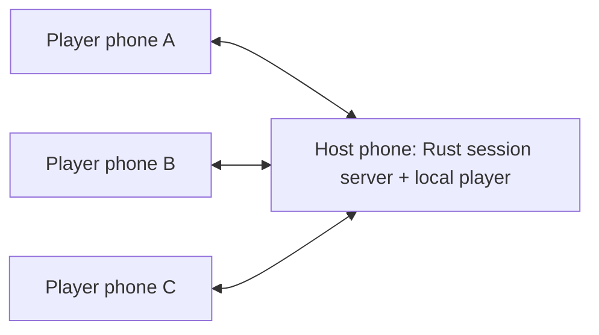

# Local-party Imposter game — working plan

Status: Android-first implementation complete; physical-device playtesting remains. Updated 2026-11-02. This document preserves the original brainstorm and proposals below. [README.md](README.md) records the delivered behavior, build instructions, verification, and current limits; [DESIGN.md](DESIGN.md) records the approved visual system.

Implementation decisions: 3–12 players, one independently random imposter, no self-votes, everyone participates in the single runoff, repeated ties mean escape, original civilian ballots determine +1 awards, and cumulative scores/punishment participation are public after resolution. Categories are chosen publicly in the lobby; private role cards show only each player's word or hint. Dare givers are randomly chosen from other connected players. Party state is in host memory and does not survive host process death. Native guest identities are saved for reconnection. Transport uses authenticated, certificate-pinned HTTPS with revisioned state polling rather than the initially proposed WebSockets. All 22 bundled topic packs have authored hints (221 pairs); hints still need human playtesting.

2026-11-02 implementation: [browser guests with an Android host](design/WEB-GUEST-IMPLEMENTATION.md), delivered as the 1.1.0 preview. Only the host needs to install the app; guests may use their updated Android app or a browser in the same party. The user confirmed offline play on the same Wi-Fi. One shared URL QR opens the browser through external readers and is parsed natively by Imposter's scanner; the Android landing page offers an explicit app-opening action where supported. The [approved plan](design/WEB-GUEST-PLAN.md) is retained below its status note. Automated browser/emulator checks passed; physical phone, camera, and shared-router validation remain pending because devices are unavailable. Browser traffic uses local HTTP with the security limits documented in the implementation record.

## 1. Product direction

Browser choice for the proposed web guest mode: respect each phone's default browser on iPhone and Android. Do not force Safari or Chrome; validate multiple modern browsers and use capability checks rather than a browser-brand restriction.

Build a social deduction party game using Tauri and Rust, with Android first and iOS later. Each player installs the app on their own phone. One player creates a local party; their phone hosts the session and also acts as their playing device. Other players join by scanning its QR code.

The app coordinates the game; clues and discussion happen face to face. No account or internet connection should be necessary for the initial local mode. For v1, everyone must connect to the same router's local Wi-Fi network and be able to reach the host. Phone-hotspot play is deferred.

Confirmed: Tauri, Rust, Android first, iOS later, individual phones, QR joining, host orchestration, same-router Wi-Fi before admission, a host background-usage prompt, untimed face-to-face discussion, one independently random imposter per round who always sees their role and a related starting-word hint, secret votes from everyone, personal loser results for incorrect guesses, most-votes accusation, one runoff for tied votes, and imposter escape on a repeated tie. Correct civilian guesses earn +1; escaping imposters earn +2; losses earn zero. Drink or Dare runs one loser at a time in app-randomized order, followed by cumulative rankings. The party continues until the host ends it and shows final rankings. Capacity, art direction, category visibility, and details explicitly marked as proposals remain open.

## 2. What the reference app does

Reviewed all 18 screenshots in `reference-images/`. This is a visual reconstruction, not a live behavior test. Details and evidence are in [REFERENCE-FLOW.md](REFERENCE-FLOW.md).

The reference flow is:

Welcome → setup players / imposter count / duration → choose topics and optional imposter hint → privately reveal each player's role on the shared phone → countdown → clues and discussion → stop timer → select a suspect → vote → result → play again.

Civilian players see the same secret word. Imposters do not, according to the tutorial. The screenshots show a single selected suspect followed by a civilian victory. They do not establish individual ballots, ties, multiple-imposter resolution, timer-expiry rules, or a last-chance word guess.

Our main improvement changes the interaction model: no passing the phone, no sequential role handoff, and no group looking at a screen that might expose a role. Each player gets a private view and shares synchronized public progress.

## 3. Recommended first-release experience

### Home

Two primary actions: **Host party** and **Join party**. Rules and preferences remain secondary. Explain in one sentence: “One phone hosts. Everyone joins on the same Wi-Fi.” Keep account creation out of the path.

### Host: create party

1. Enter display name and party name; require a Wi-Fi connection to the shared router.
2. Explain and request local-network access when required.
3. Show **Keep your party connected** host setup. On Android, explain background battery settings and provide **Open battery settings** if needed. Recheck detectable status when the app returns; do not claim that every manufacturer's setting is measurable. Guests do not receive this host-only prompt.
4. Start the host session with the validated native foreground-service strategy described below. Display an ongoing **Hosting party** notification while hosting, with a return-to-party action. Ending the party stops the service and releases any wake resources.
5. Show the lobby, QR code, router connection instructions, and connection status. Let the host supply the Wi-Fi name if platform access does not expose it, clearly treating it as a label rather than verified network identity. Do not request the Wi-Fi password.
6. Configure topics while players join. V1 uses one imposter, always provides that imposter a related starting-word hint, and has no hint toggle, duration setting, or game timer.

The background-settings explanation is part of host onboarding. If the host declines, offer **Keep app open while hosting** with clear expectations, or go back. Never silently imply that background hosting is protected. Whether unrestricted battery usage must be a hard gate for background hosting will be determined by the device spike; a settings toggle alone is not proof of reliable hosting.

The host is a player by default. Consider a separate non-playing moderator later; it must be explicit rather than consuming an invisible player slot.

### Guest: join party

1. Tap **Join party** and scan the host's code. Ask for camera permission here.
2. Validate the invitation format/expiry, then always show **Connect to the host's Wi-Fi** before joining. Explain: “Everyone must use the same router's Wi-Fi. Internet isn't required.” Show the supplied Wi-Fi name when available, with **Open Wi-Fi settings** and **Check connection** actions. Do not mark an unverified party name/host label from the QR as authenticated yet.
3. Preserve the scanned invitation while the guest changes Wi-Fi; retry on return without requiring another scan. Check Wi-Fi availability, then attempt an authenticated local connection to the host. Do not admit the player until it succeeds.
4. Show authenticated party name and host identity before confirming membership.
5. Enter a display name / choose a simple avatar, then enter lobby and tap **Ready**.

If the guest is already connected correctly, the Wi-Fi screen can quickly confirm **Host reachable** and enable **Join party**. If unreachable, explain that different Wi-Fi, isolated guest networks, denied permissions, or a stopped host can cause this; a failed connection does not prove the router is wrong. Offer retry and ask-the-host guidance. Revalidate the connection after later network changes.

Provide camera-free joining using a pasted invitation or manual host address plus invitation credential. A short party code alone cannot locate a phone offline: it needs local discovery or an address. Nearby-party discovery can come after reliable QR joining.

### Shared lobby

Show player names, host badge, connected/reconnecting status, readiness, and the agreed rules. The host can remove players before a round. Guests can leave. Avoid exposing device addresses in the normal UI.

Start requires the supported player count, a usable word pool, valid rules, and all players connected and ready. Changing rules clears readiness. Lock the active roster at round start; late arrivals wait for the next round.

Confirmed initial scope: one imposter per round. Suggested capacity: 3–12 players with bundled topics; validate the capacity through playtests. Prepare the data model for more imposters, but defer enabling that option until its win conditions are decided.

### Private role reveal

The host assigns roles and selects a word once. Choose the imposter independently and uniformly from the active players each round. The previous imposter remains eligible immediately; do not rotate, exclude recent imposters, or weight assignments for score balance. Consecutive imposter rounds are allowed and must not be hinted at through the UI. Each phone receives only its own private information. Players reveal locally using an intentional action and acknowledge **I'm ready**. Offer a straightforward tap alternative if hold-to-reveal is used.

Civilian: role, actual secret word, and a concise reminder. Imposter: explicit **You are the imposter** label, objective, and one related starting-word hint, always. Example: civilians see **Dog**; the imposter sees **Hint: Paws**. Do not mislead the imposter into thinking the hint is the actual shared word. Keep this private; no role-dependent public badges, sounds, vibration patterns, or different loading delays.

The hint is the imposter's starting clue for joining the spoken conversation. It should allow plausible bluffing without functioning as an obvious synonym, definition, or giveaway. Author and review word/hint pairs together; the chosen pack context also affects how revealing a hint is. Every playable entry must have a reviewed hint, stored with the bundled content and delivered only to the imposter. Do not send them the actual word or rely on live AI generation. Detailed authoring guidance is in TOPICS.md. Guessing the actual word does not itself end the round or award points under the agreed voting-based rules.

The shared UI shows “4 of 6 ready,” never who is an imposter. All players must acknowledge before discussion begins. Roles auto-hide on app backgrounding and are concealed on return until the owner reveals again.

### Clues and discussion

Discussion is untimed. Do not add a countdown, discussion deadline, duration setting, or automatic phase change based on elapsed time. The host publishes the starting player and public speaking order; every device shows the current phase. Players give clues and discuss aloud for as long as needed.

Recommend a suggested starting player / order without mandatory per-turn buttons for the first release. This keeps the game social and reduces phone interaction. A guided turn mode can be added if playtesting shows confusion.

When the group is ready, the host taps **Open voting** to move everyone to secret ballots. Guests may show **Ready to vote** intent, but the host owns the phase transition. Pause remains available for interruptions, not for managing a game clock.

### Voting — individual secret ballots

Each player casts an individual secret ballot on their own phone. Show clear player names/avatars, selection feedback, and **Confirm vote**. Do not broadcast partial choices or live vote counts by candidate. Show submission progress only.

Everyone, including the imposter, casts one secret ballot. Baseline interaction: no self-votes, one confirmed ballot per eligible player, no editing after confirmation, reveal only when everyone has voted. A disconnected player pauses completion rather than silently receiving an automatic vote. Voting is also untimed.

Confirmed resolution: the suspect with the **most votes** is accused; more than half of the ballots is not required. The imposter loses if accused and wins otherwise. If the top count is tied, hold one secret runoff restricted to the tied suspects. If the runoff also ties, no one is accused and the imposter escapes, winning +2. Do not choose an arbitrary suspect. A separate civilian team-result banner is optional presentation. Resolve runoff eligibility and self-vote interaction explicitly before implementation so a tied candidate always has a valid ballot.

Personal results are separate from the group accusation. A civilian who votes for the actual imposter gets **Winner — correct guess**; a civilian who votes for anyone else gets **Loser — wrong guess**, even if the group catches the imposter. The imposter is not evaluated as a civilian guessing their own identity; their result is winner if they escape the group accusation and loser if caught. A civilian who guesses correctly can therefore win personally alongside an imposter who escapes the group vote, including a repeated-tie escape.

Confirmed scoring: a civilian's correct imposter guess earns **+1 point**; an imposter escaping the group accusation earns **+2 points**. Incorrect civilian guesses and a caught imposter earn **0**, with no deductions. Awards are role-specific: the imposter does not earn an additional civilian guessing point. Role allocation stays fully random even if some players receive more opportunities for +2.

Confirmed scoring detail: use the original locked ballot for civilian personal results and their +1 point. Any runoff resolves only the group accusation, so an initially correct guess keeps its credit and later votes cannot erase an incorrect initial guess. After the accusation or repeated-tie escape is resolved, commit all round awards once, independently of punishment completion. An abandoned round before results awards nobody any points.

### Results

All phones receive the committed public result: actual imposter, secret word, and an explanation of why the round ended; include accused player and team outcome if the proposed team layer is retained. Each player also receives their own personal result and their own locked choice. Make the personal outcome primary on their screen, and distinguish it clearly from any team result. Example: **You lost — you voted for Sam. Alex was the imposter. Your team caught Alex.**

Voting remains secret until ballots are locked. Whether everyone sees a named winners/losers list after the round is still open; that list can reveal who guessed correctly even without disclosing their full ballot. Do not publish everyone's ballot or personal result by default until the group-result visibility is agreed.

Results lead into **Drink or Dare**, then **Rankings**, then replay. Do not jump straight into the next round.

### Drink or Dare — punishment phase

Confirmed: a dedicated punishment phase after the result, with losers taking turns one player at a time. The queue includes civilians who guessed wrong and the imposter if caught. A correctly guessing civilian does not receive a punishment even if the imposter escaped.

Confirmed experience: the host creates one queue from the committed loser results. Everyone sees **Sam's turn** when Sam is the active participant. Only Sam's phone offers **Drink**, **Dare**, and **Skip**; other phones show a waiting state and turn progress. Sam chooses, completes or skips the turn, and the host advances everyone to the next loser. Do not allow simultaneous punishment turns or let waiting players submit choices for someone else. Showing the current loser/turn is agreed public information; full ballots and a separate public winners/losers list are not implied by this choice.

Each turn follows **Waiting → Choose → Drink screen / named dare giver → Done or skipped → Next player**. A direct Skip from Choose also resolves the turn. The last resolved turn takes everyone to rankings. The app randomly shuffles the loser queue once per round on the host device, then synchronizes that order. The human host does not choose who goes first. Keep the order stable through reconnects.

- **Drink:** show a brief participation prompt, with a non-alcoholic choice supported; do not require camera proof, quantities, or escalating penalties.
- **Dare:** the app only names the person giving the dare. That person invents and communicates the dare in person; its content and performance are entirely outside the app. Working selection rule: the host runtime randomly chooses another connected player, excluding the current recipient. Everyone sees an unambiguous message such as **Sam gives Alex a dare**. Alex remains the punishment recipient; Sam is the dare giver. Do not generate, suggest, store, or collect dare text; no dare packs, entry form, timer, or proof. Alex can mark **Done** or **Skip** to advance the shared flow.
- **Skip:** resolve the turn without another punishment. Skipping does not change the locked game result.

The host validates completion commands against the current participant/turn ID, then advances the queue. Repeated commands cannot advance twice; reconnecting restores the same recipient and dare giver instead of selecting again. A disconnected participant can rejoin or be skipped explicitly by the host so punishment time does not deadlock the party. If the named dare giver leaves, explicitly reassign another connected player or skip, without changing points. The host cannot mark an unsubmitted game vote correct through this screen.

Keep completion status separate from win/loss: **winner/loser** is the game outcome; **pending/done/skipped** is punishment progress. Once all turns are resolved, show **View rankings**. If there are no eligible losers, bypass this phase and proceed to rankings. Drink/dare/skip never changes points. Random queue ordering and person-created dares are settled; dare-giver eligibility and host skip/reassignment controls are implementation details to finalize.

### Rankings — cumulative party scores

Confirmed addition: a ranking screen tallies each player's score. Recommended placement is after punishment time, before the next round; show the same host-authoritative standings on all devices.

Proposed scope: accumulate scores across rounds within the current party, starting everyone at zero. Each row shows rank, name/avatar, total points, and the most recent round's gain (+0, +1, or +2), with the local player clearly marked. Sort by total points descending. Equal totals share a rank; a stable display order is not a hidden tiebreaker. Example: Alex (imposter) escapes and gains +2; Sam guesses Alex and gains +1; Mia guesses someone else and gains +0. Alex and Sam both win personally in that round.

The host stores an award ledger keyed by party, round, and stable player ID. Derive totals from committed awards; never increment points again on screen entry, repeated messages, or reconnect. Preserve a reconnecting player's points and distinguish different players with the same display name. Proposed behavior: departed players remain in standings marked as left, and new players start at zero. Abandoned/unresolved rounds do not award imposter points by accident.

Offer **Next round** and **End party** to the host and show guests **Waiting for host**. There is no fixed round limit: play continues until the host ends the party. Ending it shows final rankings on every connected phone before closing the session; allow players to dismiss that final screen themselves. Keep the same scores during replay and ordinary setup changes. A score reset or new party must be explicit; confirm reset behavior and whether scores should survive host app termination before implementation. Lifetime rankings/accounts are outside the current scope.

### Replay

**Next round** from rankings keeps the party, rules, and cumulative scores, returns players to readiness, picks a fresh word, and rerolls roles. **Change setup** returns everyone to the lobby while retaining scores. Detailed round-history browsing can follow later. A new round must not begin while some phones still show an unresolved old one or punishment turn.

## 4. Local connection model

Require all phones on the same router's local Wi-Fi network for v1. QR is an invitation and connection bootstrap; scanning does not itself put devices on the same network. No cloud server is needed during a local game.

Phone-hotspot play is outside the v1 join flow. If added later, Android exposes a local-only hotspot API that creates a network without internet; it needs separate permissions and device validation. [Android local-only hotspot documentation](https://developer.android.com/develop/connectivity/wifi/localonlyhotspot).

Test guest Wi-Fi / client isolation, multiple network interfaces, VPNs, host address changes, and phones preferring mobile data on a Wi-Fi network without internet. Enforce a local Wi-Fi connection and authenticated host reachability. Do not pretend to prove physical-router identity from a QR, IP subnet, SSID, or BSSID: mesh and multi-band networks make those imperfect identifiers. The product instruction is same-router Wi-Fi; the functional admission check is a reachable, authenticated host over the local Wi-Fi interface. Do not add cloud/cellular relay as a silent fallback.

Invitation payload proposal: protocol version, party identifier, reachable host endpoint, expiry, high-entropy admission token, and a host public-key fingerprint. No word, role list, Wi-Fi password, or player secrets. Treat invitations as credentials; rotate on lobby reset and reject late joins during rounds.

Use an authenticated encrypted persistent connection. Prototype WebSocket transport owned by Rust on both host and clients; pin the host identity from the QR rather than disabling certificate validation globally. The first feasibility milestone must validate the actual TLS/pinning approach and Android networking behavior before treating this as settled.

## 5. Synchronization and authority

The host owns membership, rules, word selection, assignments, phase changes, ballot acceptance, results, scores, and the randomized punishment queue/assignments. Clients send requests such as ready, acknowledge role, submit ballot, choose drink/dare, complete turn, or skip. They cannot declare their own role, winner, points, or next phase. There is no game timer state.

The host's own player UI follows the same validated commands and filtered views. Do not provide a normal host screen that lists secret roles.

Use an explicit session state machine:

Lobby → Role reveal → Discussion → Voting → Results → Drink or Dare → Rankings → Lobby / next round.

Runoffs are a voting substate. A pause preserves its previous phase. Every message carries a session ID, round ID, protocol version, and revision; commands have unique IDs so a retried vote cannot count twice. Associate commands with authenticated connections rather than trusting a supplied player ID.

Separate public party state from per-player private state. Never broadcast the complete game state and hide secrets with styling. Reconnecting clients receive a filtered current snapshot, not a replay of obsolete secret screens. Reject actions from the wrong round or phase.

Phase transitions are action-driven, not time-driven: readiness acknowledgements, host opening voting, completed ballots, resolved punishment turns, and host replay/end actions. Remove the timer synchronization subsystem entirely. Transport heartbeats, connection timeouts, and invitation expiry remain internal reliability/security mechanisms, not player-facing game timers.

## 6. Disconnections and host responsibility

**Guest briefly disconnects:** mark reconnecting, reserve the same identity, retry automatically, and restore the latest authorized state. Store an opaque resume credential locally so reopening the app does not create a second player.

**Required player missing before results:** pause the round and allow reconnection. If they cannot return, the host abandons the round and returns everyone to the lobby; award no points for that abandoned round, while retaining previous rounds' totals. Removing an active player and continuing changes the game's information and voting balance; do not silently do it. After results are committed, a disconnect during punishment/rankings does not revoke earned points; use the separate punishment skip/reconnect handling.

**Host unavailable:** all clients show a common reconnect state. Never elect a replacement or independently continue in the first release. If the host cannot return, explain that the party ended and offer a new party.

**Android host backgrounds or locks phone:** background hosting is now a requested capability, subject to real-device validation. Build a native Android foreground service that owns/keeps the Rust session runtime alive independently of the web UI. Start it while the host screen is visible. A foreground service means user-visible ongoing work, even when the app screen is not open; it does not itself prevent CPU sleep. Verify whether bounded wake resources are needed for active hosting, release them when the party ends, and test screen-off network behavior. Evaluate the `connectedDevice` service type against this actual LAN use case and its prerequisites; do not assume eligibility or add unrelated permissions just to qualify. [Android service types](https://developer.android.com/develop/background-work/services/fgs/service-types), [foreground services and wake locks](https://android-developers.googleblog.com/2026/03/battery-technical-quality-enforcement.html).

Android battery optimization exemptions are separate from the foreground service. Explain and link to relevant settings during host setup; Android provides a battery-optimization settings route and exemption-state API. Direct exemption requests have eligibility restrictions, so do not assume a generic one-tap permission can always be requested. Labels and manufacturer controls vary. Settings changes improve reliability but cannot guarantee survival of force-stop, process termination, or network loss. [Android Doze and battery optimization guidance](https://developer.android.com/training/monitoring-device-state/doze-standby).

**iOS hosting later:** there is no general equivalent setting that grants an indefinitely running LAN game server. Background App Refresh is not a solution for continuous hosting; iOS normally suspends background apps and provides specific-purpose modes and limited execution extensions. Plan foreground-only iOS hosting with a visible keep-open explanation and pause/reconnect behavior when interrupted. If background hosting is essential for a party, recommend an Android host after that capability is validated. iOS guests can reconnect when returning to the app. [Apple background modes](https://developer.apple.com/documentation/xcode/configuring-background-execution-modes), [limited background execution](https://developer.apple.com/documentation/uikit/extending-your-app-s-background-execution-time).

Persist lobby preferences, not an unrestricted secret-bearing game dump. For the first release, host process death ends the round safely. Exact restoration and automatic host migration are later features; migration is especially complicated because transferring full authority can reveal secret assignments to another player's phone.

Trust boundary: the host app must hold the full game state. Filtering prevents ordinary UI spoilers and guest access; it does not make a modified host device unable to cheat. Strong protection against a malicious host would need a different trust model.

## 7. Tauri / Rust structure

Proposed stack: Tauri 2 mobile shell, Rust game engine and networking, React + TypeScript UI with Vite. The frontend choice is a recommendation to confirm; using Rust for game logic does not require using Rust for the UI.

- **Pure Rust game engine:** state machine, validation, random assignments, word selection, votes, results. Test without phones or networking.
- **Rust session host:** listener, authenticated connections, membership, reconnects, filtered snapshots, orchestration.
- **Rust guest session:** transport, identity, retry logic, current local view.
- **Tauri bridge:** narrow typed commands/events between UI and Rust; scoped capabilities.
- **Platform adapters:** camera, network/lifecycle integration, keep-awake, optional discovery and haptics. Verify plugin support; use small Kotlin/Swift implementations where required.
- **Bundled content:** versioned topics and words; reject empty selections and avoid immediate repeats. Guests need not receive the full selected word pool for the round to work.

Topic research and proposed catalog: [TOPICS.md](TOPICS.md), with 22 packs and 220 candidate entries covering everyday life, entertainment, science, psychology, relationships, and sex education. This is a discussion draft, not an approved/playtested release database; the candidate entries still need their reviewed hint pairs. It proposes pack previews, difficulty labels, intentional opt-in for relationship/sex-education packs, and offline bundled content. A starting-word hint is always provided to the imposter; category visibility remains to be finalized separately.

Tauri supports a web frontend with Rust, and mobile plugins can use Kotlin on Android and Swift on iOS. Keep platform code separate from shared rules and protocol. [Tauri overview](https://v2.tauri.app/start/), [mobile plugins](https://v2.tauri.app/develop/plugins/develop-mobile/).

Android local-network permission handling depends on OS and target SDK; camera access is separate. Include granted, denied, and revoked states in the join/host flow. [Android local network access](https://developer.android.com/privacy-and-security/local-network-permission).

For later iOS: validate local-network permission messaging, camera scanning, lifecycle behavior, discovery if used, and mixed Android/iOS transport. iOS requires local-network usage configuration; builds require macOS and Xcode. Shared code reduces duplicated work but does not replace iOS device testing. [Apple local-network privacy](https://developer.apple.com/documentation/technotes/tn3179-understanding-local-network-privacy), [Tauri prerequisites](https://v2.tauri.app/start/prerequisites/).

## 8. UI/UX direction to explore

Preserve the reference's suspense and quick party setup, while creating our own identity and artwork. Do not lock the new app to its full-screen red backgrounds or oversized spy illustration.

Priorities: one clear action per phase, visible connection status, strong private/public distinction, readable mixed-case instructions, comfortable contrast, accessible controls, stable layouts, and restrained motion. Keep routine game screens quiet enough that people look at each other.

Use explicit labels: **Reveal my role**, **Ready**, **Pause round**, **Open voting**, **Confirm vote**. Use color with text/icon meaning. Support large text, long names, screen readers, reduced motion, sound off, Android Back behavior, keyboard insets, and safe areas. Private content should not be announced automatically while concealed.

Design recovery states alongside the happy path: camera denied, invitation expired, wrong network, host unreachable, unsupported app version, duplicate name, full party, reconnecting, host gone, and resume after backgrounding. Use a retry action and concrete next step instead of a generic connection error.

## 9. Delivery sequence and completion gates

1. **Finalize screen brief.** Core flow is agreed: untimed discussion, independently random single imposter with explicit role and mandatory starting-word hint, secret votes, runoff/escape rules, individual scoring, randomized punishment turns, named dare givers with all dare content outside the app, rankings, and host-ended sessions. Resolve target capacity, category visibility, runoff ballot eligibility, and visual direction. Produce screen flow before implementation.
2. **Networking and hosting feasibility spike.** Two or more real Android phones create/join over QR, pass the Wi-Fi instruction/check screen, authenticate, exchange private/public messages, and reconnect. Test router Wi-Fi, no-internet Wi-Fi, wrong/isolated networks, permissions, pinned host identity, returning from Wi-Fi/battery settings, service lifetime, screen-off/Doze, battery saver, and representative manufacturer battery controls. Verify UI recreation does not terminate the Rust server, and party termination stops background work. Record supported configurations before investing in polished screens.
3. **Shared rules engine.** Cover valid/invalid starts, assignments, phase transitions, duplicate/stale commands, vote accounting, ties, and result calculation with deterministic tests.
4. **Complete Android vertical slice.** Host → join → ready → private reveal → untimed discussion → private vote / optional runoff → personal results → Drink or Dare → rankings → replay or host-ended final rankings, entirely without internet or accounts. Test consecutive imposter eligibility, repeated-tie escape, original-ballot civilian points, abandoned rounds awarding zero, randomized punishment order/dare-giver selection, duplicate completion, skips, reconnects, cumulative totals, equal-score ranks, and exactly-once awards across repeated messages and screen visits.
5. **UX and reliability pass.** Playtest joining and rule comprehension; test maximum agreed player count, slow/disconnected clients, abandoned rounds, accessibility, screen sizes, battery/lifecycle effects, and no secret leakage in messages or logs.
6. **Android release preparation.** Device matrix, permission copy, packaging/signing, content review, and a release checklist based on the chosen distribution channel.
7. **iOS port and mixed-device validation.** Bring up the same protocol/engine on iOS, implement platform adapters, and test Android-host/iOS-guest and iOS-host/Android-guest separately.

No delivery dates yet: the network spike and agreed scope should drive estimates.

## 10. Deferred possibilities

Automatic nearby-party discovery; phone-hotspot play and in-app hotspot creation; multiple imposters; last-chance word guessing; guided clue turns; custom word packs; languages; lifetime/cross-party rankings; spectator/moderator mode; shared-phone fallback; cloud/remote parties; host migration.

Remote parties require a separate connectivity/server design. A QR code containing a private LAN address will not make a party accessible over the internet.

## 11. Decisions for the next brainstorm

1. Settled: v1 uses the same router's Wi-Fi, with a post-scan connection screen before admission; hotspot play is deferred.
2. Settled: individual secret votes from everyone, personal loser results for wrong guesses, and most-votes accusation. Civilian accuracy uses original ballots. Confirm whether to show a separate team result and a full named personal-results list after the round.
3. Settled: one imposter in v1, chosen independently at random each round; the same player can be imposter consecutively. Multiple imposters are deferred.
4. Settled: no game timers; host opens voting when the group is ready. One runoff for tied top counts; repeated tie lets the imposter escape for +2. Resolve runoff ballot eligibility/self-votes as an interaction detail.
5. Settled: imposter always sees their explicit role and one related starting-word hint (Dog → Paws), not the actual word. Voting remains the win condition; there is no separate word-guess win mechanic. Finalize whether the round category is also public; author and playtest hints in that context.
6. Host setup must prompt for Android background usage; validate native background hosting before promising it. For later iOS, plan foreground hosting. Decide whether a non-playing moderator is needed.
7. What visual personality should we explore after the rules are settled?
8. Settled: personal losers take Drink or Dare turns one at a time in app-randomized order; everyone sees the active player's name. On Dare, show who gives the dare; that person thinks of and communicates it outside the app. No generated or stored dare content. Working rule: randomly choose another connected player as giver. Finalize eligibility and host skip/reassignment controls.
9. Settled: cumulative rankings, +1 correct civilian / +2 escaping-imposter / zero-point losses, and play until host ends with final rankings. Confirm shared-rank display, late arrivals/departures, reset controls, and persistence beyond the current party process.
