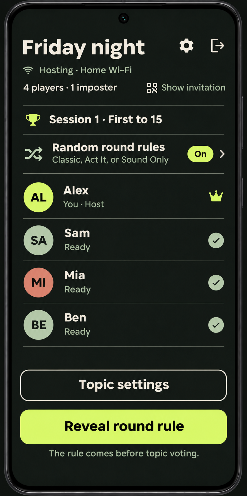
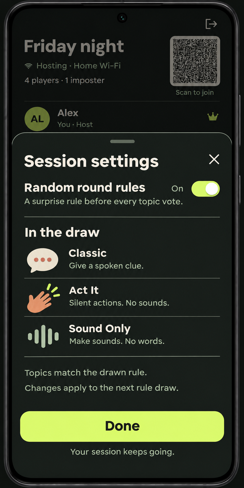
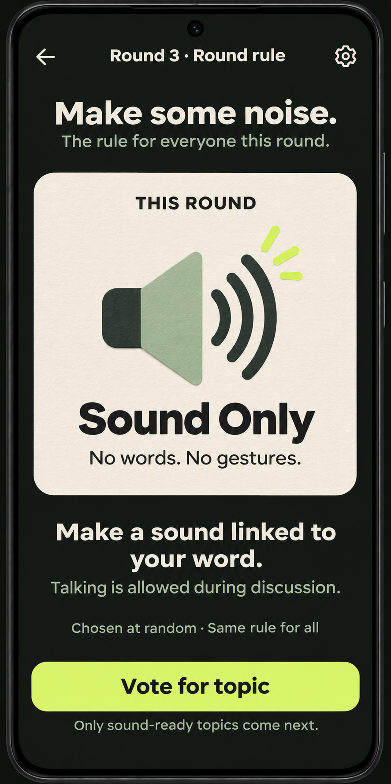
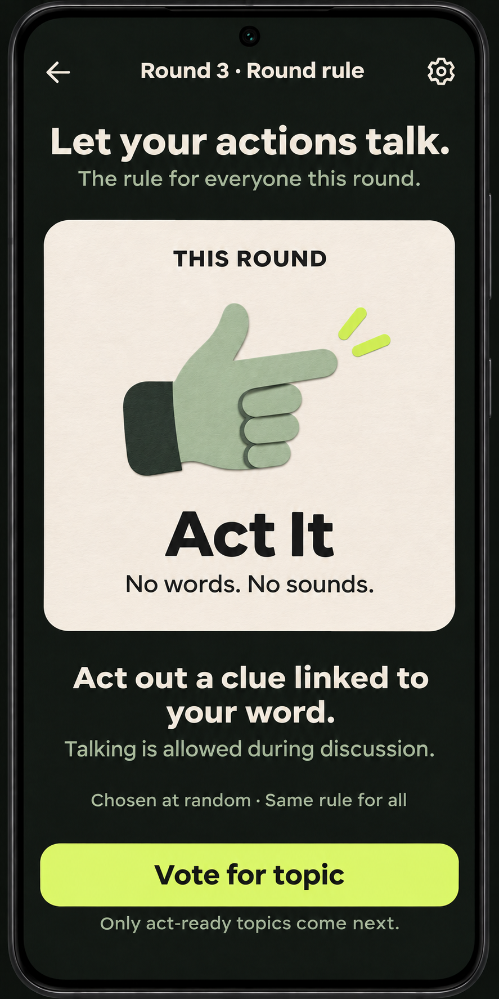
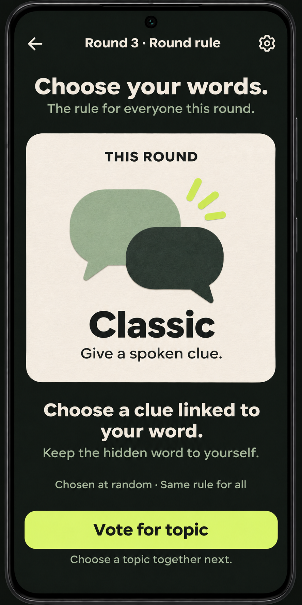
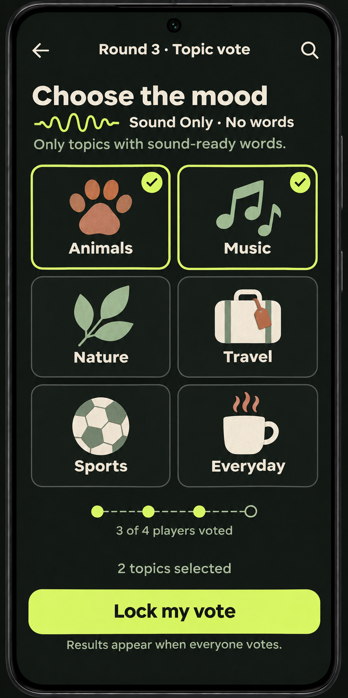
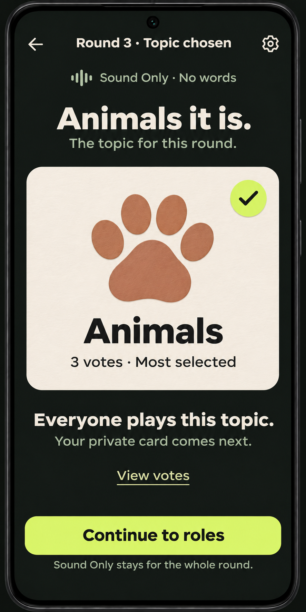
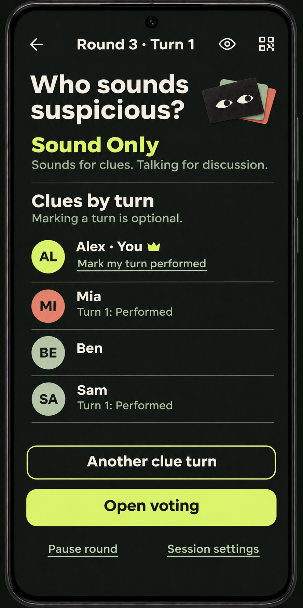
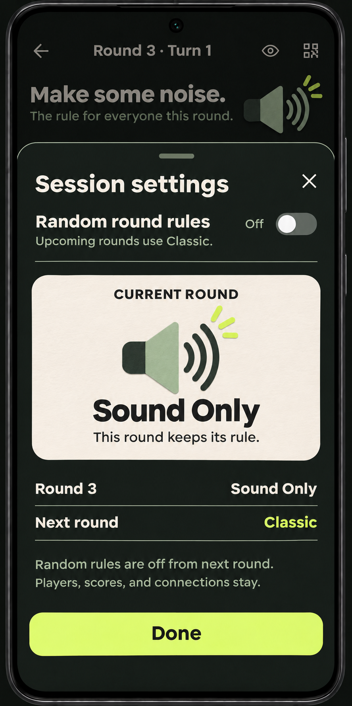

# Random round rules — mockups v1

Status: **Proposed, awaiting user review.** Created 2026-11-17 with the built-in image-generation tool. These are visual mockups; the feature has not been implemented.

The screen interiors extend the approved system in [DESIGN.md](../../DESIGN.md): charcoal, warm ivory, sage, lime, DM Sans-style rounded typography, flat dividers, circular initials, paper-cut illustrations and large bottom actions. Device frames are presentation only.

The [end-to-end implementation plan](IMPLEMENTATION-PLAN.md) covers the rule-first flow, session toggle, reviewed content, persistent word/concept deductions, recent clue-family spacing, safe imposter hints, storage, transport, UI and verification. Its explicit fresh-deck policy supersedes the temporary selector's automatic word-pool refill; the new policy is planned, not implemented.

## Flow and review order

Main Sound Only example: **1 → 2 → 3 → 6 → 7 → private cards → 8 → 9**. Screen 2 is an optional settings visit. Screens 4 and 5 are alternative outcomes of the same random rule draw, not later steps in Round 3. Screen 9 is an optional settings visit during the round.

1. [Host lobby](01-host-lobby.png) — visible random-rules summary, settings access and **Reveal round rule** before topic voting.
2. [Session settings on](02-session-settings-on.png) — one toggle for the mechanic, with all three possible rules explained.
3. [Sound Only reveal](03-rule-sound-only.png) — public rule for everyone; topic voting comes next.
4. [Act It reveal](04-rule-act-it.png) — alternative random outcome with the same card layout.
5. [Classic reveal](05-rule-classic.png) — alternative random outcome with the same card layout.
6. [Sound-compatible topic ballot](06-sound-topic-vote.png) — filtered topics and a persistent rule reminder, preserving approval voting.
7. [Chosen topic](07-sound-topic-chosen.png) — public Animals result, Sound Only reminder, then private cards.
8. [Sound Only clue turn](08-sound-clue-turn.png) — in-person sounds, optional Performed markers, host controls and session settings access.
9. [Random rules off from next round](09-session-settings-off-next-round.png) — toggle off, current Sound Only rule retained, next round Classic.

## Proposed behavior represented

- With random rules on, Classic, Act It and Sound Only are possible outcomes. Draw only from rules supported by the enabled content; eligible rules have equal chances, and repeats are possible.
- The rule is drawn and revealed before topic voting. Once revealed it stays fixed through the round, additional clue turns and reconnects.
- Topic voting shows compatible topics, and word selection uses compatible words inside the chosen topic. The six topics in the ballot are illustrative candidates; actual eligibility depends on an authored word and hint review.
- Mode restrictions apply to clue-giving. Players can speak during discussion and accusations.
- Act It uses silent actions. Sound Only uses player-made sounds without words or gestures as extra clues. Sounds and actions happen in person; there is no capture, recording, soundboard or text-clue requirement in these modes.
- The optional Performed marker is a proposed memory aid. Missing markers are normal and do not block voting, advance a timer or affect scoring.
- Host settings remain accessible during the party. Changes before a rule draw affect that draw; after a reveal, changes affect the next round. The same deferred behavior applies when enabling the mechanic during a Classic round.
- Switching the mechanic does not reset players, connections or scores. The existing scoring, reports, voting and punishment sequence continues.
- Settings changes apply when toggled. **Done** closes the sheet; it is not a second save or approval step.
- Guests see the public rule and topic result. Host-only controls become waiting text for guests.
- Private role cards retain the existing conceal/reveal behavior. They are omitted from this feature mockup set because their main layout is unchanged.
- Invitation access remains available. The compact **Show invitation** treatment in the lobby is a proposed space-saving entry to the existing QR, not a replacement invitation mechanism.

## Images

### 1. Host lobby

### 2. Session settings — on

### 3. Sound Only reveal

### 4. Act It reveal — alternative draw

### 5. Classic reveal — alternative draw

### 6. Compatible topic voting

### 7. Chosen topic

### 8. Sound Only clue turn

### 9. Off from next round

## Generation record

[Exact prompts, reference paths and original generated paths](prompts.json). The original generated PNGs remain unchanged in the Codex generated-images folder; copies are saved alongside this review.

Visual QA: inspected all nine generated images for readable copy, complete controls, design continuity, private-information separation and rule-before-topic flow. Four-player ballot progress is consistent with the example; the chosen Animals topic has three approvals. These images are proposals for review, not evidence of a working implementation or device testing.
