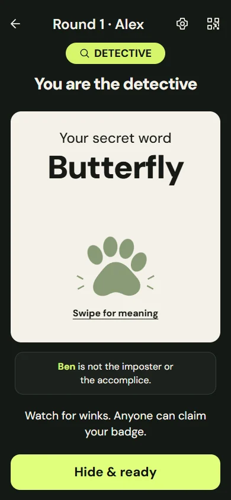

# IMPOSTER website

A single-page app tour and Android download page, based on the user's HTML reference. Static HTML, CSS, and progressive JavaScript; no build step, analytics, accounts, or external font service. Download buttons resolve the newest GitHub release's `*-android.apk` (and its `.sha256`) through the public releases API on page load; the static hrefs point at v1.3.2 as the no-JavaScript fallback. A new release needs no site change as long as its APK keeps the `imposter-<version>-android.apk` name.

Local preview: `python -m http.server 8799 --directory docs`, then open `http://localhost:8799/`.

## Publish with GitHub Pages

The site is live at **https://malon0825.github.io/imposter-app/**. GitHub Pages deploys from the `main` branch's `/docs` folder (Settings → Pages → Deploy from a branch), with HTTPS enforced. Every change merged into `docs/` on `main` publishes automatically within a few minutes.

The `.nojekyll` file keeps deployment static. Relative asset paths work at the repository's `/imposter-app/` URL. The app and APK do not depend on this public website for offline gameplay.

## Screenshots

All captures are the actual app with sample players, in the 1.3 case-file theme, as WebP at 390×844. `scripts/site-capture.js` plays a 6-player round with random rules for the setup, cast, round, turn and rule screens; `scripts/cards-capture.js` supplies the power-card row (`cards-*`); `scripts/visual-capture.js`, opened at `/?capture=site&width=390&height=844`, supplies the joining screens (`02`–`08`, `17`, `22`). Then `python -I scripts/site-screens.py` converts them into `docs/screens/`. The two browser landing captures come from the production guest flow against the real Rust host.

 

## Verification

Checked at 320, 360, 390, 768, 1024, 1280, and 1440 pixels: no page overflow, all images load, eight complete screenshot rows, working versioned download links, keyboard gallery scrolling, image-dialog Escape/focus behavior, 20 repeated preview cycles, installation help, reduced motion, and the no-JavaScript fallback. The site uses the app's DM Sans and Anton fonts with their licenses beside the font files.
