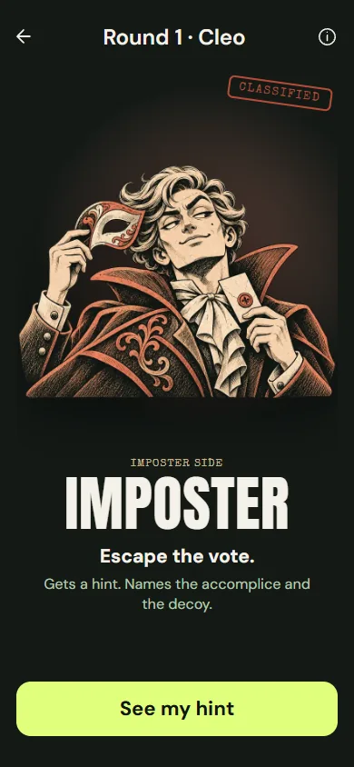

# IMPOSTER website

A single-page app tour and Android download page, based on the user's HTML reference. Static HTML, CSS, and progressive JavaScript; no build step, analytics, accounts, or external font service. Download buttons resolve the newest GitHub release's `*-android.apk` (and its `.sha256`) through the public releases API on page load; the static hrefs point at v1.2.1 as the no-JavaScript fallback. A new release needs no site change as long as its APK keeps the `imposter-<version>-android.apk` name.

Local preview: `python -m http.server 8799 --directory docs`, then open `http://localhost:8799/`.

## Publish with GitHub Pages

The intended address is **https://malon0825.github.io/imposter-app/**. GitHub Pages is not enabled yet: the connected `ItsMark-SE` account has push access but no repository admin/maintain permission, and the create-Pages API returned HTTP 404.

The repository owner can activate the completed site:

1. Open [Settings → Pages](https://github.com/Malon0825/imposter-app/settings/pages).
2. Under **Build and deployment**, choose **Deploy from a branch**.
3. Select **main** and **/docs**, then **Save**.
4. Wait for the Pages deployment to finish. The address above will then serve this page; later changes under `docs/` publish automatically.

The `.nojekyll` file keeps deployment static. Relative asset paths work at the repository's `/imposter-app/` URL. The app and APK do not depend on this public website for offline gameplay.

## Screenshots

All captures are the actual app with sample players. Round screens (`cast-*`, `round-*`, `turn-*`, `rule-*`) are Full Cast captures from `scripts/full-cast-smoke.js` and the Full Cast host-flow run. Setup and joining screens (`01`–`08`, `17`, `22`) come from `scripts/visual-capture.js`; they did not change with Full Cast. All app screens are WebP at 390×844. The 1.2.1 changes (the Accomplice's vote note and the removed Detective fine) appear only on the Accomplice's ballot, which the site doesn't show, so no capture needed refreshing. The two browser landing captures come from the production guest flow against the real Rust host.

 

## Verification

Checked at 320, 360, 390, 768, 1024, 1280, and 1440 pixels: no page overflow, all images load, six complete screenshot rows, working versioned download links, keyboard gallery scrolling, image-dialog Escape/focus behavior, 20 repeated preview cycles, installation help, reduced motion, and the no-JavaScript fallback. The site uses the app's DM Sans and Anton fonts with their licenses beside the font files.
