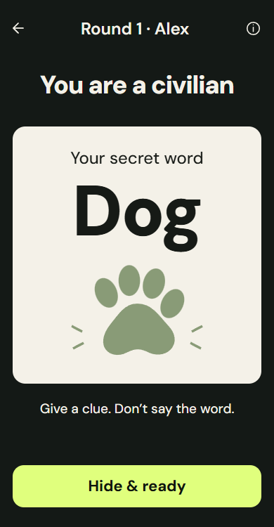
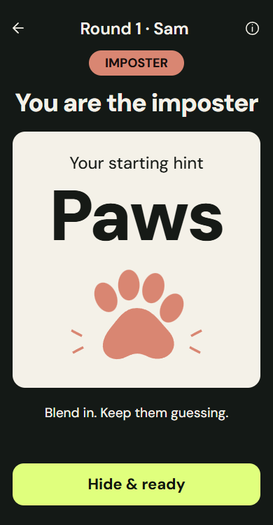
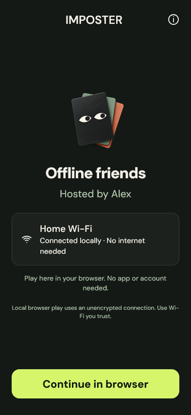
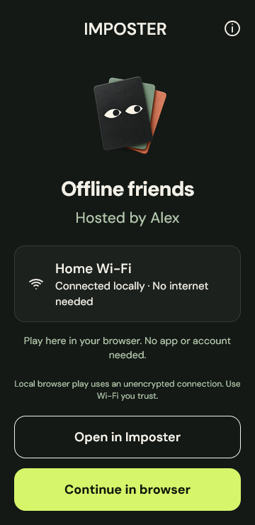

# IMPOSTER website

A single-page app tour and Android download page, based on the user's HTML reference. Static HTML, CSS, and progressive JavaScript; no build step, analytics, accounts, or external font service. Downloads point directly to the signed **v1.1.0** APK and checksum in GitHub Releases.

Local preview: `http://127.0.0.1:1428/docs/` while `npm run dev` is running. The site also works with any static file server serving this directory.

## Publish with GitHub Pages

The intended address is **https://malon0825.github.io/imposter-app/**. GitHub Pages is not enabled yet: the connected `ItsMark-SE` account has push access but no repository admin/maintain permission, and the create-Pages API returned HTTP 404.

The repository owner can activate the completed site:

1. Open [Settings → Pages](https://github.com/Malon0825/imposter-app/settings/pages).
2. Under **Build and deployment**, choose **Deploy from a branch**.
3. Select **main** and **/docs**, then **Save**.
4. Wait for the Pages deployment to finish. The address above will then serve this page; later changes under `docs/` publish automatically.

The `.nojekyll` file keeps deployment static. Relative asset paths work at the repository's `/imposter-app/` URL. The app and APK do not depend on this public website for offline gameplay.

## Screenshots

These are captures of the actual app interface with sample players, not the proposal boards. The 24 native-layout captures were refreshed from the current production React components using `scripts/visual-capture.js`. Their native command responses are isolated demonstration fixtures; they are not proof of physical camera/router behavior. The two browser landing captures come from the production guest flow against the real Rust host.

 

 

The website displays all six native screen flows plus both browser joining screens. Clicking a screen opens an accessible full-size preview; without JavaScript it opens the original PNG. Galleries scroll with touch or keyboard, help uses native disclosures, and reduced-motion preferences disable entrance effects.

## Verification

Checked at 320, 360, 390, 768, 1024, 1280, and 1440 pixels: no page overflow, all images load, six complete screenshot rows, working versioned download links, keyboard gallery scrolling, image-dialog Escape/focus behavior, 20 repeated preview cycles, installation help, reduced motion, and the no-JavaScript fallback. The site uses the app's DM Sans and Anton fonts with their licenses beside the font files.
